[Nic's intro goes here: LatinR, Medellín, the people, the community.]

The slides are at <https://thisisnic.github.io/latinr/>.

*A note on how this was written: the talk wasn't recorded, so I did a shortened run-through into speech-to-text, had Claude turn the transcript and my slides into a first draft, and then edited it myself so that it says what I meant.*

## Learning with AI

The way people talk about AI in 2026 takes me back to 2016, when I was trying to get into data science.

{width="35%" fig-align="center" fig-alt="Nic in 2016, dressed for a job interview"}

I'd finished my PhD in psychology and statistics, and I'd fallen in love with R. I wanted a way of combining programming and statistics, and I'd heard about this field called data science that did that.

2016 was a weird point to be getting into data science. There was a huge amount of hype, and all of these courses said you needed R and Python and SQL and Bayesian methods and neural networks and XGBoost and parsing XML and about 70 million other things. Harvard Business Review was calling it the sexiest job of the 21st century. A lot of us got in and found out we actually spent 80% of the time cleaning data.

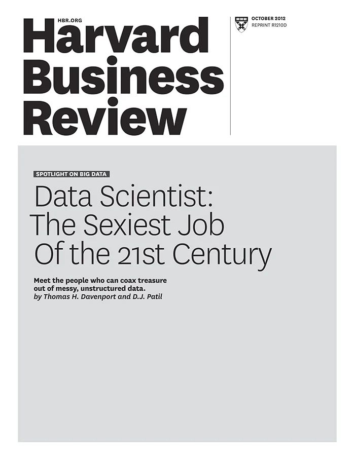{width="30%" fig-align="center" fig-alt="Harvard Business Review article: Data Scientist, the sexiest job of the 21st century"}

I made a big neurotic list of all the skills I needed to build, and I really did think I had to complete it to be a data scientist. I only got so far. I applied for a few jobs, got one anyway, and never looked at that list again. There are things on it I still don't know to this day.

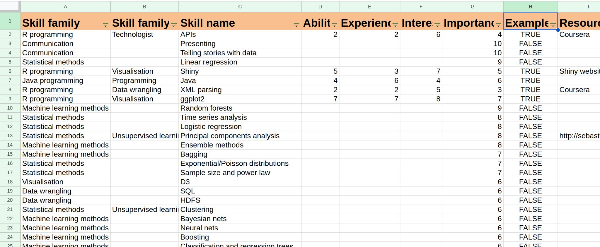{width="75%" fig-align="center" fig-alt="A spreadsheet from 2016 listing all the data science skills I thought I needed to learn"}

People were looking for a mythical creature, the data science unicorn: one person with a skill set that you really want distributed across a team.

{width="20%" fig-align="center" fig-alt="The data science unicorn"}

This reminds me of 2026. People are talking about all these different things to do with AI, and it feels big and overwhelming. In some ways it feels like the same hype cycle all over again.

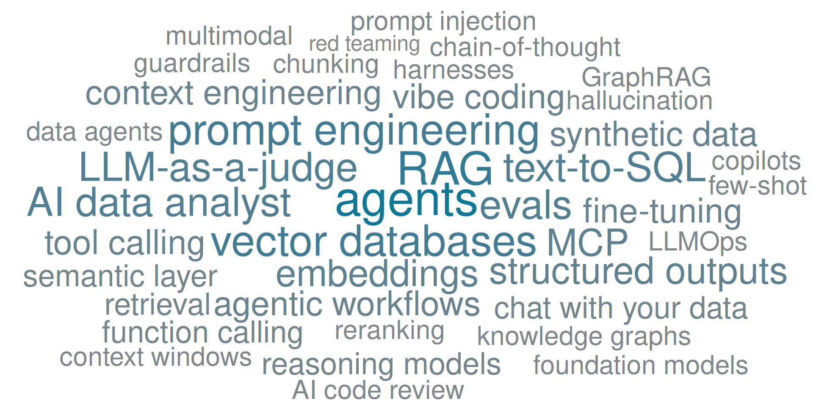{width="75%" fig-align="center" fig-alt="A word cloud of 2026 AI buzzwords: agents, RAG, vector databases, prompt engineering, evals, MCP and many more"}

[Research by Cat Hicks](https://osf.io/preprints/psyarxiv/2gej5_v2) found that nearly half of developers show signs of AI skill threat: the idea that their current competencies are going to become obsolete because of AI. It's even more pronounced in women, gender minorities and other minoritised people. The good news is that the antidote is being part of a learning culture, whether that's the organisation you work for or something you cultivate in your own work.

That brings me to another mythical creature: the centaur. I heard about Cory Doctorow's book on the reverse centaur from Wes McKinney's keynote at posit::conf this year. A centaur has the head and torso of a human and the body of a horse: human judgement and thinking, with the speed and strength of the horse. It's a human assisted by AI. You get to exercise all your current skills, with something added on.

{width="20%" fig-align="center" fig-alt="A centaur: the head and torso of a human on the body of a horse"}

The reverse centaur is a horse's head on human legs. It can't do much other than shuffle around and go neigh. It's the worst of both worlds: an AI assisted by a human. It's pressing yes to every prompt without paying attention. It's pasting your data into an AI and sending the results to somebody without checking them, and they turn out to be wrong.

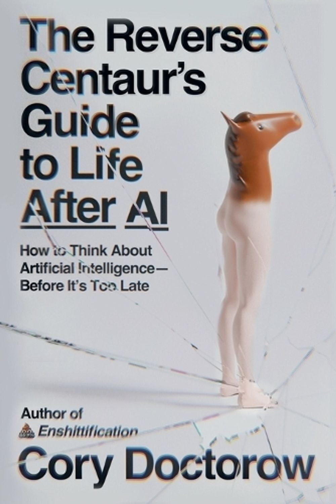{width="25%" fig-align="center" fig-alt="The cover of Cory Doctorow's book on the reverse centaur"}

So the question is: **how can we use AI so we become more capable, and not dependent?**

## Learning about code

I made my first open source contribution in 2018, and in 2021 I started working on Arrow. Learning to maintain it was a lot of work. My mentor, Jon Keane, created issues for me to work on and pointed me at similar ones to look at. A lot of it was reading code really slowly, line by line, and drawing diagrams of how the pieces fit together. It was only really possible because I was working on it full time.

There was a lot of learning by analogy: I fixed this in this pull request, somebody else fixed that in theirs, so I should do it this way over here. One of my first Arrow PRs was in C++, despite the fact I'd never written a line of C++ in my life. When I'm learning by analogy, I don't necessarily understand exactly what I'm doing, but I do get it done. Done means the tests pass and the reviewer accepts it.

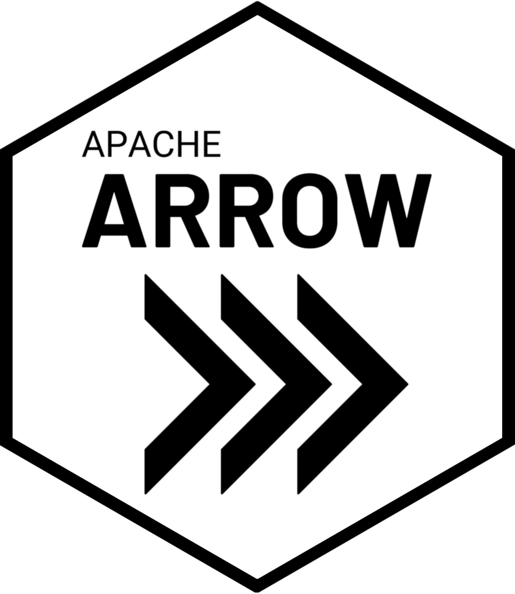{width="25%" fig-align="center" fig-alt="The Apache Arrow logo"}

Flash forward to 2026, and I'm working on [ellmer](https://github.com/tidyverse/ellmer), an R package for working with LLMs directly from R. This was different. I was working more independently, I had to get up to speed a lot faster, and I was only part time. But this time I had AI to help.

The first thing I used was [DeepWiki](https://deepwiki.com/). You give it any GitHub repository and it creates a wiki explaining what's in there, how the code is structured, and how things fit together, with diagrams. I don't think it's perfect, but for a high-level view of the main ideas without diving into the code, it's fantastic.

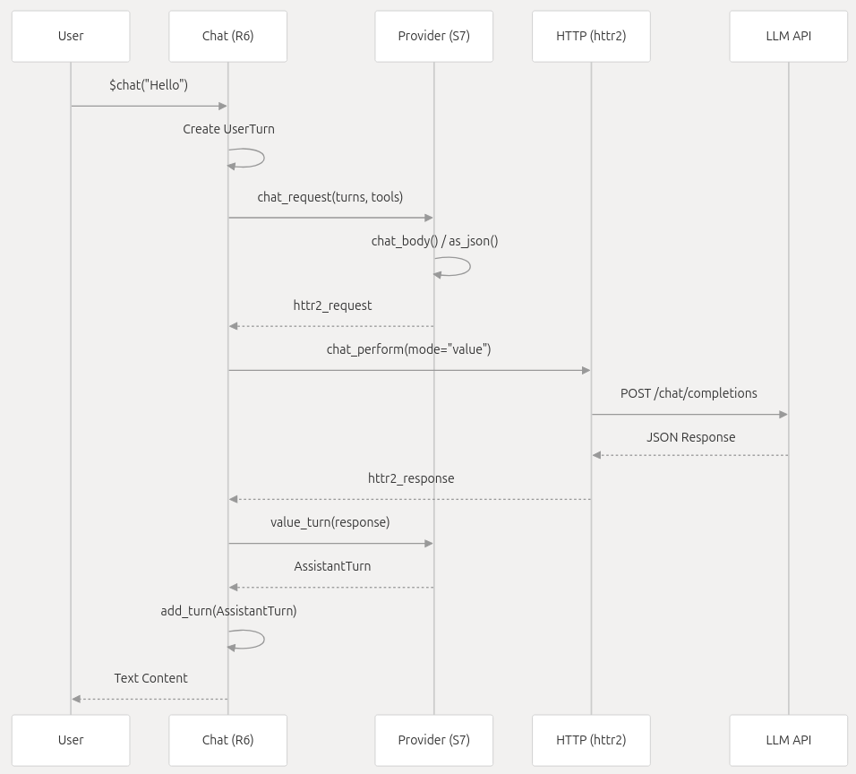{width="60%" fig-align="center" fig-alt="A DeepWiki sequence diagram showing how a chat works in ellmer"}

For writing code, I mostly use Claude Code with skills. A skill is a markdown file that defines a process or a set of rules the agent uses every time. Or more simply, it's a way of adding your own knowledge into the process. There are loads of existing ones, but I much prefer writing my own. Getting a workflow written down makes me question why I'm doing things a certain way, and sometimes improve it.

So it's really easy to generate code. The big question is: how can I trust the code that I generate? The only answer that makes sense to me is that I've got to understand it. Can I use AI to help me understand it? Yes.

A paper by [Lin (2023)](https://doi.org/10.1177/10451595231184928), "Using LLMs for self-directed learning", describes a five-step framework for teaching yourself. The framework predates AI, and the paper describes where AI can help at every step. So I took the framework and the recommendations, customised them, and turned them into a skill.

The skill is at <https://github.com/thisisnic/rapid-learning>, and I wrote more about it in [an earlier post](../rapid-learning-skill/index.qmd).

My example was: how do tool calls work in ellmer? A tool gives the LLM access to information by running R code. If I ask a model what the time is, it can't tell me:

```r
library(ellmer)
chat <- chat_anthropic()

chat$chat("what's the time")
#> I don't have access to real-time
#> information, so I can't tell you
#> the current time.
```

But if I wrap `Sys.time()` up as a tool and register it with the chat, it can:

```r
time <- tool(
  fun = Sys.time,
  description = "Get the time",
  name = "time"
)

chat$register_tool(time)

chat$chat("what's the time")
#> ◯ [tool call] time()
#> ● #> "2026-11-12 08:40:46"
#> The current time is **8:40:46 AM**.
```

I know the LLM can't run code on my machine. So who called `time()`? Here's a shortened version of how the skill took me through it, following the five steps of the framework.

**1. Establish learning goals.** The skill starts by asking what I want to learn and why, where I'm starting from, how I'd like to learn, and how much time I have. My answers were: how tool calling works in ellmer; I've used tools before but that's it; by running code; 10 minutes. It turned that into a specific, time-bounded goal and a way of getting there:

::: {.chat names="🤖,Nic" self="2"}
::: {.speaker-1}
**Primary learning goal:** by the end of 10 minutes, be able to explain what happens between asking a question and getting an answer, and where a tool call fits in.
:::
::: {.speaker-1}
**Supporting objective:** compare a conversation with and without a tool call and spot the difference.
:::
:::

If I was learning this on my own, I wouldn't spell things out like this. I do sometimes find myself reading through code and forgetting why I was reading it in the first place, so even just having an explicit goal is brilliant. And I wouldn't have known how to get there, because I hadn't read the code yet.

**2. Locate and access resources.** If this wasn't about code, the agent would ask me what kind of resources I wanted to learn from. Here I'd said I wanted to learn by running code, so the resource was an R session with ellmer loaded, and there wasn't much more to it.

**3. Adopt and execute learning activities.** The important bit of this step is that it doesn't tell me the answer. It asks me questions and sends me to go and look at things, so I learn by figuring it out. It usually suggests two to five small activities, and I'll show one here: have a conversation without a tool call and one with, and after each, run `chat$get_turns()` to list everything sent back and forth.

Without a tool call there are two turns, mine and the assistant's, exactly as you'd expect:

```r
chat$chat("Say hi!")
#> Hi there! 👋
#>
#> How are you doing today? I'm happy to help with whatever you need...

chat$get_turns()
#> [[1]]
#> <Turn: user>
#> Say hi!
#>
#> [[2]]
#> <Turn: assistant>
#> Hi there! 👋
#> ...
```

With a tool call, there are four:

```r
chat$register_tool(time)
chat$chat("what's the time")
#> ◯ [tool call] time()
#> ● #> "2026-11-12 08:43:13"
#> The current time is **8:43:13 AM**.

chat$get_turns()
#> [[1]]
#> <Turn: user>
#> what's the time
#>
#> [[2]]
#> <Turn: assistant>
#> [tool request (toolu_01CW...)]: time()
#>
#> [[3]]
#> <Turn: user>
#> [tool result (toolu_01CW...)]: "2026-11-12 08:43:13"
#>
#> [[4]]
#> <Turn: assistant>
#> The current time is **8:43:13 AM**.
```

Then it asked me about what I was looking at:

::: {.chat names="🤖,Nic" self="2"}
::: {.speaker-1}
What do you see in the second turn?
:::
::: {.speaker-2}
The assistant turn is calling `time()`?
:::
::: {.speaker-1}
Is it calling it, or requesting it?
:::
::: {.speaker-2}
Oh. Requesting.
:::
::: {.speaker-1}
Right. The model never calls anything. It only asks. And what do you see in the third turn?
:::
::: {.speaker-2}
There's a user turn with the result, but I didn't type that.
:::
::: {.speaker-1}
So who ran `time()`?
:::
::: {.speaker-2}
...ellmer?
:::
::: {.speaker-1}
And who did it send the result to, and as whom?
:::
::: {.speaker-2}
To the LLM. As me?
:::
::: {.speaker-1}
Yes. Why would it need to do that?
:::
::: {.speaker-2}
So the LLM has what it needs to answer.
:::
:::

So that's the answer. The model only ever requests the tool. ellmer runs the R function itself, gets the result, and sends it back to the LLM as if I'd sent it myself.

**4. Monitor and evaluate performance.** As we go, it does checkpoints where it asks me to explain things in my own words, to make sure I really understand before moving on. It congratulates me if I get it right, corrects me if I don't, and writes things to a file as we go.

::: {.chat names="🤖,Nic" self="2"}
::: {.speaker-1}
Checkpoint before we move on. In your own words: who decides to use the tool, who runs it, and who sees the result?
:::
::: {.speaker-2}
The LLM decides, ellmer runs it, and the LLM gets the result as if I'd sent it.
:::
::: {.speaker-1}
That's the whole mechanism, and you got there yourself. 🎉 Activity 1 done, five minutes under its timebox.
:::
:::

**5. Reassess learning strategies.** At the end it asks what worked and what didn't, and updates the skill itself based on my feedback. I said the most valuable thing was comparing the two conversations side by side, and it noted that it should lead with a comparison next time.

What did this give me? It takes away the overhead of planning how to learn, so I can get straight to the learning, and I'm more ambitious about what I take on. And I have more confidence in what I learn. On Arrow I was learning by analogy. This teaches me how things actually work, so learning with AI is going deeper than learning on my own did.

**Use AI to customise learning to make it work for you.**

## Learning through experimentation

Code is a known entity. But how do we use AI to learn about things that aren't known yet?

It was early 2026, I was working on Arrow, and I wanted to ask: what can I work on that I can be sure is having an impact? So I loaded up Positron with Posit Assistant and the frontier models of the time, and asked it for an R script showing the number of new contributors per month. I care about new contributors because I got a lot of help when I was getting started myself, and I wanted to make sure we were doing a good job of onboarding.

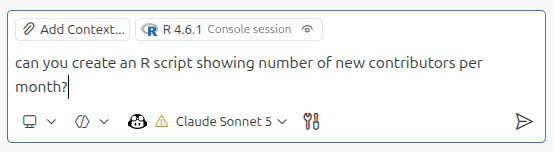{width="50%" fig-align="center" fig-alt="Posit Assistant in Positron"}

The plot was fairly steady, a few new contributors every month, and then a massive peak in January 2026. There's probably something here about agents getting cheaper and easier to use, and more people trying to get involved.

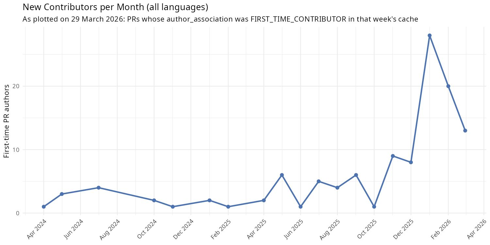{width="75%" fig-align="center" fig-alt="A plot of new contributors to Arrow per month, steady and then with a large peak in January 2026"}

That's great, but how successful are these new contributors? Are their pull requests getting merged? So I got it to look at that, and got a flat line. It looked like nothing was being merged.

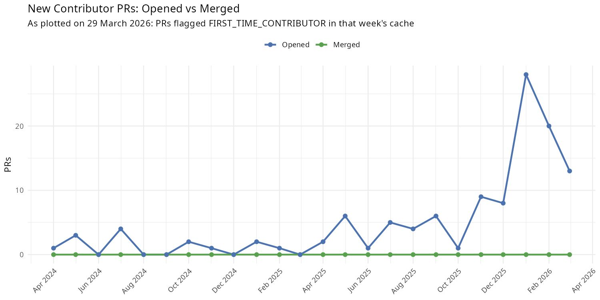{width="75%" fig-align="center" fig-alt="A plot of new contributor pull requests opened versus merged, where the merged line is flat at zero"}

What was actually going on is that we merge pull requests into Arrow with a script, which does a few extra bits and pieces. On GitHub it looks like the pull request was closed without merging, when it actually was merged. So when the agent queried the GitHub API, it looked like nobody had got anything merged. That wasn't true, but it took a moment to figure out.

The funny thing is that I'd been getting it to write everything up as a Quarto report as I went, and it gave me some quite damning commentary about how bad an experience this was for newcomers. One thing it said was that there was a big stack of pull requests sitting there unacknowledged. When I looked, it was 16 pull requests opened within three minutes of each other. It said they weren't AI generated. Of course they were, and they'd been closed by the person who opened them in the first place.

::: {.chat names="🤖,Nic" self="2"}
::: {.speaker-1}
These PRs are sitting entirely unacknowledged, which is both a poor contributor experience and a growing triage burden for maintainers.
:::
::: {.speaker-1}
Some are substantive pieces of work (look at \<list of PRs\>) that just didn't make it through.
:::
::: {.speaker-2}
😢
:::
::: {.speaker-2}
🤔
:::
::: {.speaker-2}
Don't add judgemental comments about poor contributor experience please, just report the facts.
:::
::: {.speaker-2}
Hmm... how do you know? These were opened within 3 mins of each other...
:::
:::

So some of its conclusions were complete bollocks, and the commentary was leading me in a certain direction. What I took from it: don't have it write the commentary. Have it report the facts, and I'll write the commentary.

After that minor trauma, I carried on. I worked out a better way of calculating first contributions, and got a plot of what actually happens to new contributors' PRs. A load of them get merged. Some get closed without merging, for various reasons. And a lot are still open, skewed towards the more recent ones, which makes sense: it can take a while to get a review, especially after that horrible January peak.

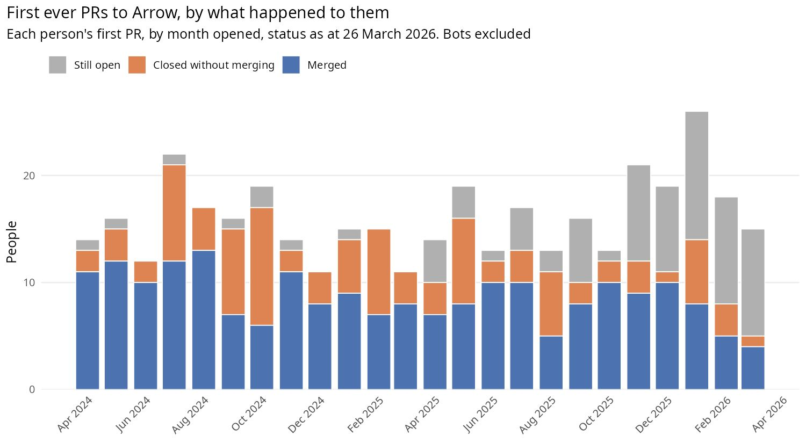{width="75%" fig-align="center" fig-alt="A plot of new contributors' first pull requests by outcome: merged, closed without merging, or still open"}

Asking these questions, each one following from the last, gave me a new way of categorising open pull requests:

-   **Active**: there's been a comment in the past two weeks. People are working on it, so leave it alone.
-   **Abandoned**: the last comment was from a maintainer over two months ago, with no response from the author. They got a review and did nothing with it. That's fine, but we need to decide what to do with it.
-   **At risk of going stale**: the last comment was from the author over a month ago, and they're waiting on a maintainer. They can't move it forward on their own.

This sent me back to my original question. I'd been thinking about new contributors, but new contributors seemed to be turning up perfectly fine. The question I actually wanted to ask was: what can I do that helps things move forward on the project? I can find the stale pull requests and either answer the question myself or ping the right maintainer. I can find the abandoned ones and either finish them off, if they're easy, or close them.

What I learned was that the wrong answers were still useful. The AI did an okay-ish data analysis and I had to poke at it a lot, but that made me learn a lot more about how we do certain things on the project and how that shows up in GitHub's data. And because I was iterating quickly through questions, not spending my time writing code, I could ask more questions, more diverse ones, keep going for longer, and get deeper into what was really going on.

Two things mattered most. One is domain knowledge. I knew we merge things from new contributors, because I write a Bluesky post thanking them at every release. If I hadn't known that, I might not have realised the plot was wrong.

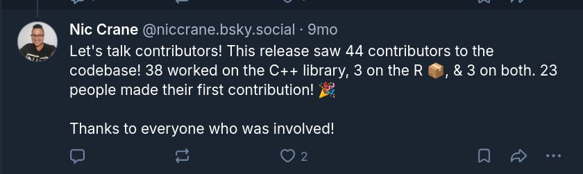{width="50%" fig-align="center" fig-alt="A Bluesky post thanking the new contributors to an Arrow release"}

The other is scepticism: knowing it isn't perfect, and pushing on it, and pushing again.

It's also worth tempering our expectations in both directions. AI output looks fluent, so it looks believable, and then when it's wrong it's tempting to decide AI is crap. But humans get things wrong too. I found a bit of our maintainer dashboard where I'd made the same mistake with first contributors myself. Finding the AI's mistake is what sent me back to fix my own.

**Use AI to run experiments cheaply and learn about your reality.**

## Boundaries in open source

So far I've been talking about things we can do with AI to remain capable and not become dependent. But I also want to think about how we adapt the way we work, so we can work with AI and not get frustrated by it or end up fighting it.

Remember the January spike?

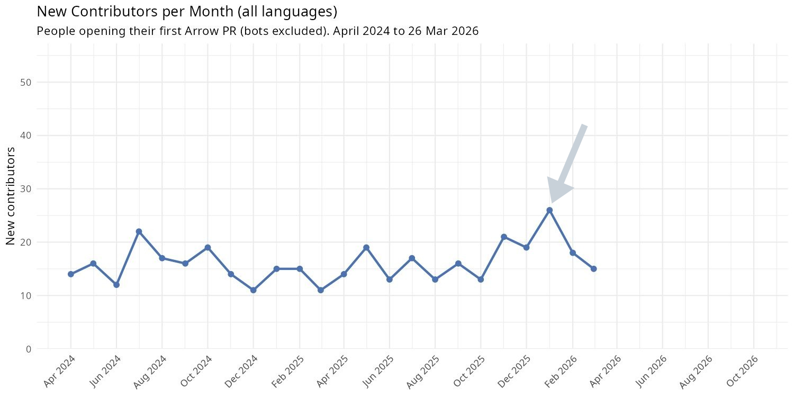{width="75%" fig-align="center" fig-alt="The new contributors plot, with the January 2026 spike highlighted"}

In January 2026 there were loads of new contributions to Arrow, and they had some shared characteristics. They had far too many unit tests. The people never really interacted much, and it felt like they were copying our responses, pasting them straight into an LLM, and pasting back whatever came out. It was frustrating and unsatisfying as a maintainer, and nobody was learning anything. If someone's going to paste things into an LLM, the maintainers may as well do the pull request themselves, and do a better job of it.

So we introduced some AI guidelines. Only submit a pull request if you can debug and own the changes yourself, and be upfront about your AI usage. We don't ban it and we're not against it. We want to know which bits are human, where we can teach and guide, and which are just AI.

Did it work? Nobody paid any attention to it. Reviewing code became a really frustrating experience. A lot of us love open source because of the community, the human side of it, and that had dropped out. We also turned on automatic AI review with Copilot, which was fine, but it was wrong a lot of the time. So now I had to read the code, and read Copilot's review of the code, and fix that too.

The real issue was volume. I re-ran the plot a couple of weeks before the talk, and there had been another sharp uptick. The problem had got massive.

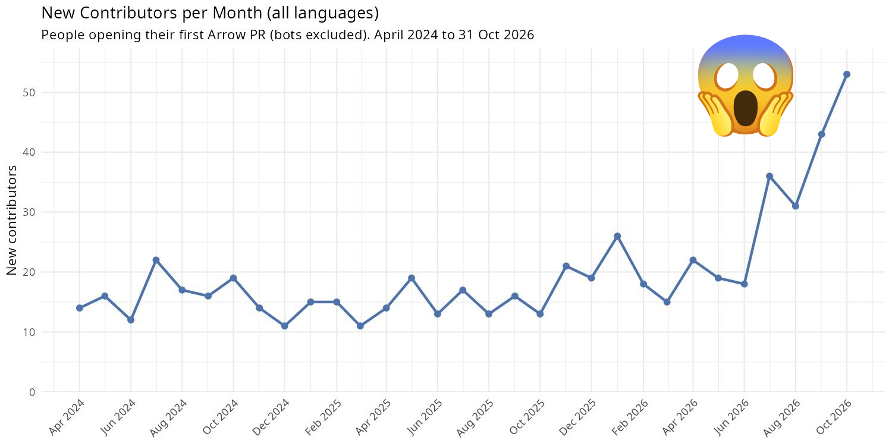{width="75%" fig-align="center" fig-alt="The new contributors plot updated to October 2026, showing another sharp uptick"}

So how do maintainers keep up? It's tempting to just consume all the caffeine. There are more pull requests, so let's review them, or close them if there's no engagement, but let's keep up. You end up feeling that you just need to try harder.

I went looking for analogies. I asked Google: how do air traffic controllers maintain concentration? They work for a maximum of 90 minutes to two hours at a time and take long breaks between shifts. Not that useful to me. It's also frankly ridiculous to compare landing a plane with checking a pull request for tiny mistakes.

{width="50%" fig-align="center" fig-alt="Air traffic controllers at work"}

Then I thought maybe it wasn't concentration, maybe it was decision fatigue. Mark Zuckerberg wears the same t-shirt every day so he has fewer decisions to make. And at that point I went: what the hell am I doing? I don't want to be more like Mark Zuckerberg. He is not someone in tech I aspire to be like.

{width="30%" fig-align="center" fig-alt="Mark Zuckerberg's wardrobe of identical grey t-shirts"}

I realised I was becoming the reverse centaur.

What changed things was a conversation on Bluesky. Somebody was complaining about AI-generated pull requests, and Hadley Wickham replied saying he felt like he was missing something, because no one is forcing you to read it. You can just say thanks, but not interested.

{width="50%" fig-align="center" fig-alt="Hadley Wickham's Bluesky reply saying that no one is forcing you to read it"}

I stopped and thought about it. That's right. No one is forcing me to read it. What I was actually struggling with was comfortably saying no to people.

So I went back to AI and asked: how do prominent maintainers say no on pull requests that get closed without merging? The answer is that they thank the person, explain why, and move on with their lives. The most useful thing I got from it was the final sentence of the summary: a pull request is a proposal, not a gift.

A proposal is my friend saying "I've got a spare ticket for a concert tonight, do you want to come?" I might go, I might not, depending on whether I like the artist. A gift is my dad knitting me a horrible jumper for Christmas, and I have to accept it, pretend I like it, and make the best of it.

So the solution is about setting boundaries, and this applies to all of life, not just code:

-   You're allowed to say no without long justifications. I'm not going to read a 300-line AI-written pull request description.
-   Focus on your own actions, not the other person's. I can't stop people submitting AI-generated pull requests, but I can choose which ones get my time.
-   Phrase it as "if X, then Y". If a human is clearly engaged, I'll put effort in. If not, I might close it without review.

And the Copilot mess, where it reviews the pull request and I clean up after it? I now do an AI draft of the review locally. I read it, and I choose what from it makes sense to post. AI is still cutting down the time it takes. I'm just not relying on it entirely.

**Change how you work, but don't change who you are.**

## Wrapping up

I started by talking about 2016, but we can go back a lot further to see how people react to new technology. Around 370 BC, Socrates said that reading and writing would ruin people's ability to memorise things and recite them from memory. In the 1970s, people thought pocket calculators would mean we lost the ability to do mental arithmetic. In the 1990s, people complained that the internet would cost us our library research and critical thinking skills.

In all of these cases there was some truth in it. Certain skills absolutely did atrophy. But at the same time, the possibilities for what we could do massively increased. And that is the bit that is exciting to me.
